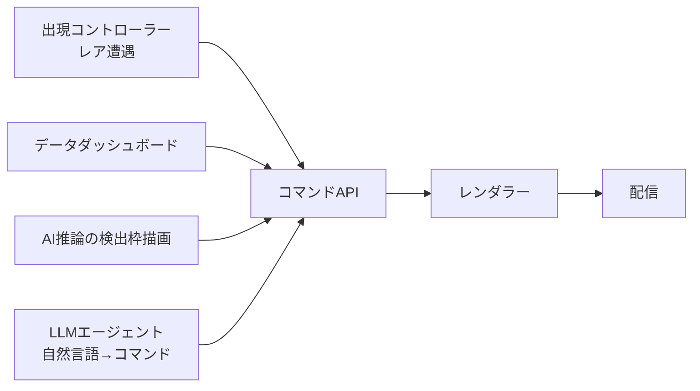

# Overlive

**overlay + live** — 配信中の映像に、プログラムの判断でキャラクターやオブジェクトを重ねて動かす、ヘッドレスな配信基盤。

> **ステータス: 構想段階。** まだ実装はない。設計の詳細は[構想草案（v0.3）](docs/overlive-draft.md)にまとめている。

## 概要

完成済みの動画ファイル（例: 風景映像）をライブ配信しつつ、**配信中の映像にプログラムの判断でキャラクターを紛れ込ませる**。
ファイル本体には手を加えず、配信の瞬間にだけキャラクターが現れる。視聴者は「珍しいキャラに偶然出会った」という体験を得る。

目指すのは「**人がPCの前にいなくても、プログラムの判断で映像が変わり続ける配信**」。配信を「録画の再生」から「状態を持つプログラムの出力」に変える。

ただしレア遭遇の演出は最初の用途にすぎない。本体は**ライブ映像の上の表現をコマンドで操れる基盤**として設計する。

## 仕組み

ライブ配信は必ず「デコード → フレーム → 再エンコード → 送出」を通る。
フレームがただのピクセル配列になる瞬間に別の画像を重ねてからエンコードすれば、元ファイルを壊さずに視聴者の映像にだけキャラクターが写り込む。

```
動画ファイル ──デコード──▶ フレーム ──合成──▶ フレーム ──エンコード──▶ RTMP送出
                                      ▲
                                      │ 出現コントローラーの判断で
                                      │ キャラクターを重ねる
```

Overliveが担うのはRTMPで送り出すところまで。トランスコードやCDNでの配布はYouTube / Twitch 等のプラットフォームが引き受けるので、配信側の負担は上り数Mbps分で済む。
閉じた用途なら、自前RTMPサーバー（MediaMTX / SRS 等）にも同じように送れる。

## 設計方針

### OBSを使わず、ヘッドレスで組む

OBSは「画面があって人が操作する」前提のアプリで、サーバーで動かすには仮想デスクトップが要り、重く、自動復旧もしにくい。
配信SaaS（LiveReacting / StreamNeo 等）はループ再生とテンプレートまでで、外部プログラムから制御する口がない。

そこで、ffmpeg / GStreamer 等の画面を必要としない部品でパイプラインを自前で組み、プログラムから制御する（構想草案の「B案」）。

- サーバーやDockerで無人運用でき、落ちてもsystemd / Dockerで自動復旧できる
- 構成はコマンドと設定ファイルなので、そのまま複製・再現できる
- 引き換えにOBSのプレビュー・シーン管理・ブラウザソースを失うので、確認用出力や合成部分は自分で作る
- 試作は手元のOBS（obs-websocketで外部制御）で行い、演出の形が固まってからヘッドレスに移す

### 演出はコマンドで「意図」を送る

ヘッドレスなだけではSaaSのループ配信と差がつかない。第二の特長として、画面上のオブジェクトの移動や変化をユーザーが自由に指定でき、それをコマンドで表せるようにする。

毎フレーム「今x=100」「次はx=103」と位置を送ると、30fpsなら毎秒30回の指令が要り、到着時刻の揺れでカクつく。
そこで「3秒かけて(100,200)→(1500,200)へ、ease-outで移動」という**意図**を1回だけ送り、毎フレームの補間はレンダラーが計算する。

つまりアニメーションの記述言語を設計することになる。何でもできる言語を目指すと「ヘッドレスのAfter Effects」になって終わらないので、最小の語彙から3層で積み上げる。

| 層 | 内容 | 例（記法は仮） |
|---|---|---|
| 低 | レイヤーの生成・削除、変形（位置・拡大・回転・不透明度）、重ね順 | `create layer A` / `set A.x = 100` |
| 中 | tween（目標値・所要時間・イージング）、直列・並列の合成、パス移動 | `tween A.x → 1500 over 3s ease-out` |
| 高 | 名前付きの振る舞い。ユーザーが自分で定義できる | `peek-from-left(A)` / `walk-across(A, 8s)` |

- 最初の語彙は**レイヤー・変形・tween・時刻**の4つに絞る
- 時刻は配信の時間軸上で指定する。送ったコマンドを記録すれば同じ演出を後から再現でき、遭遇ログもコマンドログと一体化する
- コマンドはJSONのような**宣言的データ**で、スクリプトではない。受け取る側は解釈して描画するだけで、第三者のコードを実行しない

## 構成（予定）

| コンポーネント | 役割 | 実装方針 |
|---|---|---|
| レンダラー | 動画ファイルを実時間ペースでループ再生し、デコード・合成・エンコードしてRTMPで送出 | 既製品（ffmpeg / GStreamer / ヘッドレスChromium）を使う。合成部分は方式次第で自作 |
| 出現コントローラー | いつ・何を・どう出すかを決め、コマンドを発行する | 自作。レア遭遇演出の本体 |
| コマンドAPI | コマンドを受け取り、レンダラーに伝える | 自作。コマンド言語の設計が核 |
| アセット管理 | キャラ素材とメタデータ（レアリティ、サイズ、出現位置、効果音） | 最初はJSON/YAML 1枚 |
| 遭遇ログ | いつ・どのキャラが・どこに出たか、その時の視聴者数 | 自作（SQLite等） |
| 確認用出力 | GUIの代わりに合成結果を確かめる（ローカルHLS / 定期スクリーンショット） | 自作（必須） |
| 外部シグナル連携 | チャット・視聴者数・時刻・天気 | 任意。後から追加 |
| プロセス監視 | 落ちたら自動再起動 | systemd / Docker |

出現コントローラーは状態機械（待機 → 出現判定 → 出現中 → 退場 → クールダウン）を持ち、出すキャラはガチャの排出率表と同じ構造のレアリティ表で抽選する。
乱数の出どころはコントローラー側で閉じ、判定と結果をログに残す。これが希少性を信用してもらう根拠になる。

### レンダラーの候補

意図単位の補間をレンダラーに持たせるには、ffmpegの`overlay`フィルタだけでは足りない。

| 方式 | 内容 | 位置づけ |
|---|---|---|
| B-1: ffmpegフィルタ | `overlay`フィルタを`zmq` / `sendcmd`で実行中に操作する | 最小構成。コマンド言語の補間には不足 |
| B-3: 自作合成 | デコード／エンコードはffmpeg（PyAV等）に任せ、フレームの合成を自分のコードで行う | 代替候補。自由だが、イージングや透過合成まで全部自作になる |
| B-4: ヘッドレスブラウザ | ヘッドレスChromiumでHTMLを描画し、フレームをffmpegに流す | **第一候補**。CSS / Web Animations / Lottie 等、アニメーションの仕組みが最初から揃っている |

B-4なら、自分のヘッドレス配信と他の配信者のOBS（ブラウザソース）で同じレンダラーがそのまま動く。弱点はCPU負荷と、フレーム取り出しの時間精度。
最終選択（B-3かB-4か）は未決。方式の番号は構想草案の§2.4に対応する。

## ロードマップ（案）

| Phase | 内容 | 完了条件 |
|---|---|---|
| 1 | 自宅PCのOBSで、手動でキャラを出し入れして演出を試す（ブラウザソース） | 「出た瞬間が嬉しい」演出の形が決まる |
| 2 | 出現コントローラーを独立したプログラムにし、obs-websocketでOBSを制御する。レンダラーとのインターフェースは抽象化しておく | OBSが自動でキャラを出し、ログに残る |
| 3 | レンダラーをヘッドレスに差し替え、確認用出力を用意して、サーバー（VPS or 自宅サーバー）で動かす | PCを落としても配信が続き、キャラが出る |
| 4 | 自動再起動、ループの継ぎ目処理、監視（配信が落ちたら通知） | 数日放置して止まらない |
| 5 | 外部シグナル連携（チャット・天気）を追加。演出が窮屈ならレンダラーを移行する | — |

Phase 3は当初B-1（ffmpeg）への差し替えを想定していた。コマンド言語を採るならB-1では足りないため、先にコマンド言語の最小仕様を固め、それが載るレンダラー（B-4）を選ぶ方が手戻りが少ない可能性がある。要再検討。

## 今後の構想

### コマンドAPIの利用者を増やす

コマンド層ができると、出現コントローラーは「コマンドを発行する客の1つ」にすぎなくなる。



「キャラを重ねる」と「検出枠やデータを重ねる」は同じ処理なので、同じ基盤をデータのテレビ化（サイネージ）、カメラ映像へのAI推論結果のオーバーレイ、固定カメラの自動実況、ライブコマースの自動化、自動字幕・翻訳の合成などにも使い回せる。

### 配信者ネットワーク

オブジェクトとコマンドを配信者に渡す経路を作れば、同意した他の配信者の生配信にもオブジェクトを出せる。
配信者のOBSにブラウザソースのURLを1つ貼ってもらい、中央サーバーから内容を送り込む。アラート系サービス（StreamElements、Streamlabs 等）と同じ構造の延長で、技術的には成立する。

これを応用すると生配信上の広告配信になるが、いきなり広告から始めず、まず面白いことを流して仕組みと参加者を作る。

1. **単独**: 自分の配信でレア遭遇
2. **ネットワーク化**: 参加配信のどこか1つにキャラが現れる横断的なレア遭遇、全配信共通の天気・季節・一斉イベント
3. **収益化**: 配信者が十分集まった後、同じ経路に広告枠を載せる

難所は技術の外側にある。配信者の制御権（出してよいカテゴリ・サイズ・頻度・事前承認）、プラットフォーム規約、計測と課金、両面市場の立ち上げ。

## 未決事項（主なもの）

- [ ] コマンド言語の最小仕様（最初の語彙をレイヤー・変形・tween・時刻の4つに絞るか）
- [ ] レンダラーの最終選択（B-3 自作合成 か B-4 ヘッドレスブラウザ か）
- [ ] YouTube・Twitchの配信内第三者広告・スポンサー表示に関する現行規約の確認
- [ ] 出現条件（純粋なランダムか、外部シグナルも使うか）と、レアリティの段階数・排出率
- [ ] 遭遇ログの公開方法（遭遇記録ページを作るか）
- [ ] サーバーの置き場所（VPSか自宅サーバーか）

全項目は構想草案の§6を参照。

## ドキュメント

- [docs/overlive-draft.md](docs/overlive-draft.md) — 構想草案（v0.3）。技術説明、従来の手法（OBS / SaaS）との比較、用途、ロードマップ、未決事項、コマンド言語、ネットワーク化と広告への応用、用語集
