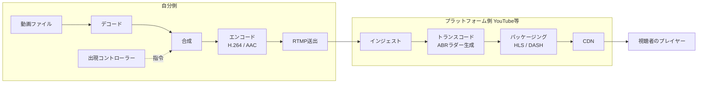
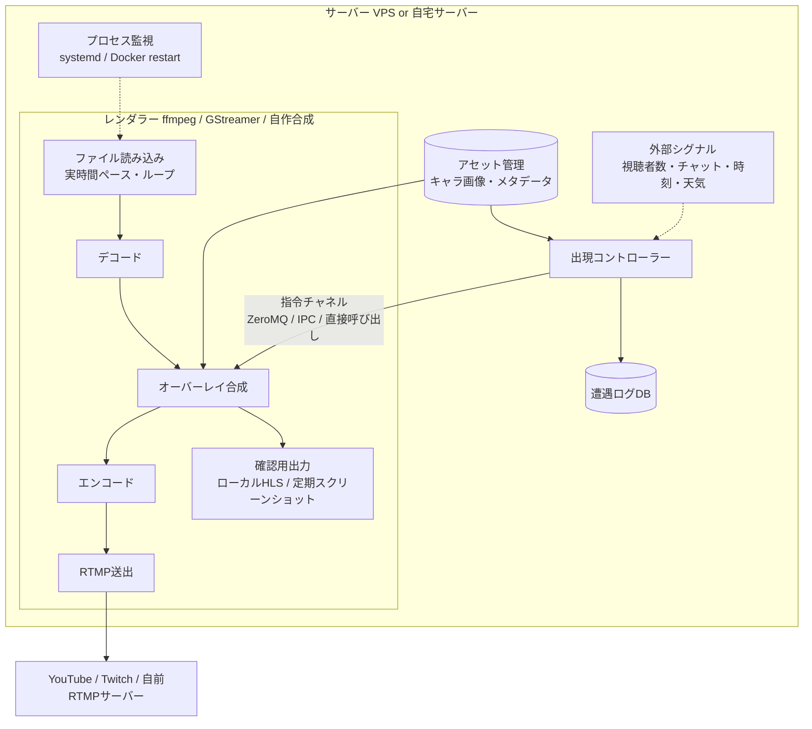
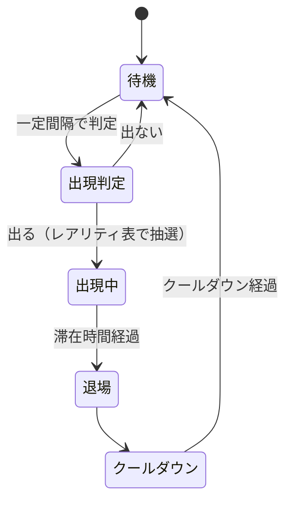
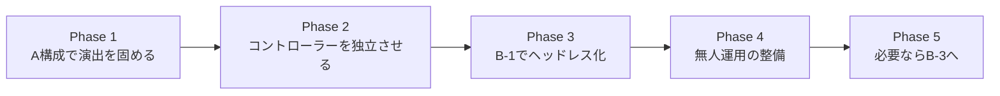
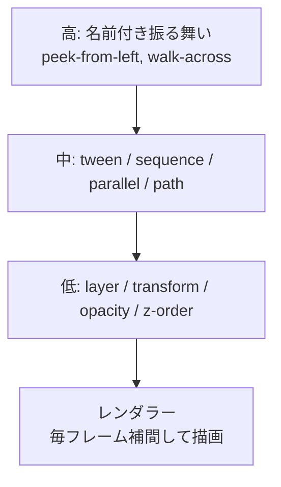
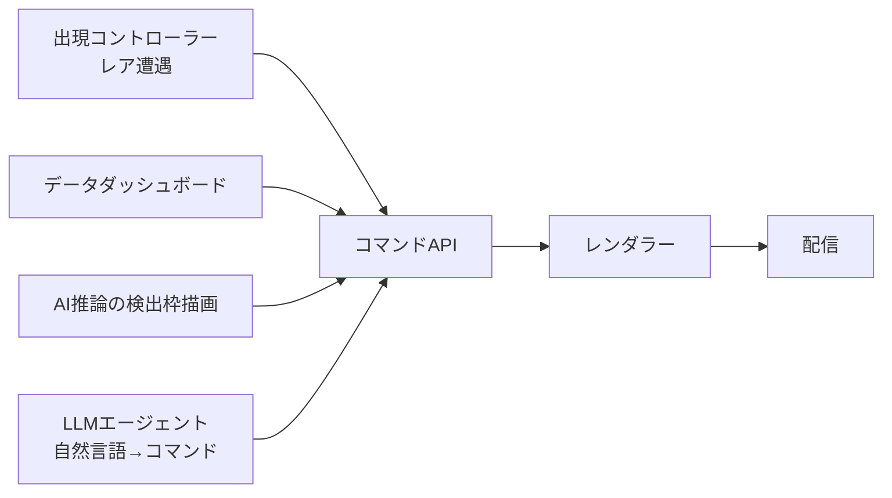
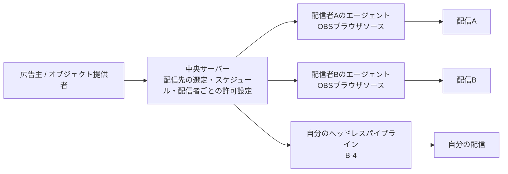
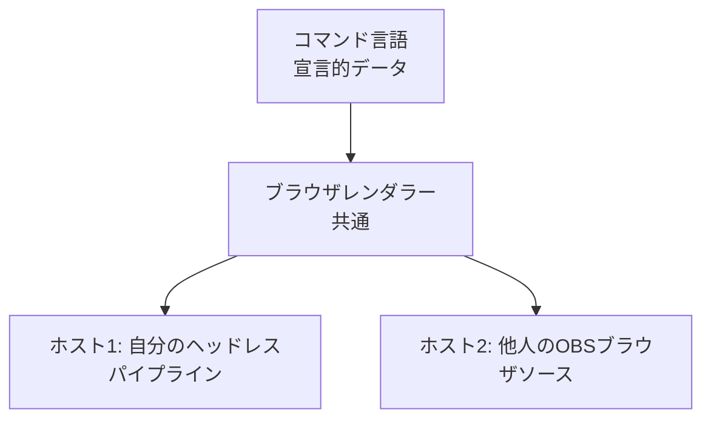
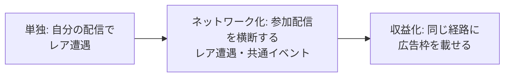

# Overlive 構想草案

- プロジェクト名: **Overlive**（overlay + live）。GitHubリポジトリ名も `overlive` とする
- 文書種別: 構想草案（v0.3 — §7 コマンド言語の構想、§8 ネットワーク化と広告への応用を追記）
- 作成日: 2026-11-01
- 対象: 自分用の設計メモ。今後の実装・検討の土台にする
- ステータス: B案（ヘッドレス自前パイプライン）を採用方針として記述

---

## 1. 概要

### 1.1 やりたいこと

完成済みの動画ファイル（例: 風景映像）をライブ配信しつつ、**配信中の映像にプログラムの判断でキャラクターを紛れ込ませる**。
ファイル本体には手を加えず、配信の瞬間にだけキャラクターが現れる。視聴者は「珍しいキャラに偶然出会った」という体験を得る。

### 1.2 なぜ成立するか

ライブ配信は必ず「デコード → フレーム → 再エンコード → 送出」を通る。
フレームがただのピクセル配列になる瞬間が存在するので、そこに別の画像を重ねてからエンコードすれば、元ファイルを壊さずに視聴者の映像にだけキャラクターが写り込む。

```
動画ファイル ──デコード──▶ フレーム ──合成──▶ フレーム ──エンコード──▶ RTMP送出
                                      ▲
                                      │ 出現コントローラーの判断で
                                      │ キャラクターを重ねる
```

### 1.3 採用方針: B案

| 案 | 内容 | 採否 |
|---|---|---|
| A | 手元PCのOBSで合成し、obs-websocketで外部制御 | 試作段階で利用 |
| B' | サーバー上の仮想デスクトップでOBSを動かし、obs-websocketで制御 | 中間案として保留 |
| **B** | **OBSを使わず、ffmpeg/GStreamer等でヘッドレスのパイプラインを自前で組み、プログラムから制御** | **採用** |
| C | 映像は無加工で配り、視聴側のブラウザでキャラを重ねる | 不採用（YouTube等で成立しない、希少性を偽装できる） |

B案を採る理由は「**人がPCの前にいなくても、プログラムの判断で映像が変わり続ける配信**」を実現したいから。詳細は §4。

---

## 2. 技術説明

### 2.1 ライブ配信の全体像（プラットフォーム側を含む）



| 段階 | 担当 | 内容 |
|---|---|---|
| 1. エンコード・送出 | **自分（B案の範囲）** | ファイルをデコードし、合成し、再エンコードしてRTMPで送る |
| 2. インジェスト | プラットフォーム | ストリームキーで認証し受信。オリジンになる |
| 3. トランスコード | プラットフォーム | 複数画質（1080p/720p/480p…）を生成 |
| 4. パッケージング | プラットフォーム | 数秒単位のセグメントとマニフェストに変換。HTTPで配れる形にする |
| 5. CDN | プラットフォーム | エッジにキャッシュして大量の視聴者へ配信 |
| 6. プレイヤー | 視聴者 | マニフェストをポーリングし、画質を選んでデコード |

**B案が担うのは段階1のみ。** CDNを含む配る側はプラットフォームが無料で引き受ける。YouTubeを出力先にすると、自分が負担するのは上り数Mbps分だけで、視聴者数千人分の下りはYouTubeが持つ。

### 2.2 B案のパイプライン構成



### 2.3 コンポーネント一覧

| # | コンポーネント | 役割 | 自作の有無 |
|---|---|---|---|
| 1 | レンダラー | デコード・合成・エンコード・送出 | **既製品を使う**（ffmpeg / GStreamer）。合成だけ自作する選択肢あり |
| 2 | 出現コントローラー | いつ・何を・どう出すかを決める。状態機械を持つ | **自作（本体）** |
| 3 | 指令チャネル | コントローラーの決定をレンダラーに伝える | **自作**（ZeroMQ / HTTP / 直接呼び出し） |
| 4 | アセット管理 | キャラ素材とメタデータ（レアリティ、サイズ、出現位置、効果音） | 最初はJSON/YAML 1枚 |
| 5 | 遭遇ログ | いつ・どのキャラが・どこに出たか、その時の視聴者数 | **自作**（SQLite等で十分） |
| 6 | 外部シグナル連携 | YouTube Live Chat API、視聴者数、天気API等 | 任意。後から追加 |
| 7 | 確認用出力 | GUIがないので合成結果を見るための出力 | **自作**（必須） |
| 8 | プロセス監視 | 落ちたら自動再起動 | systemd / Docker の設定 |

### 2.4 レンダラーの実装方式（3段階）

| 方式 | 合成の担い手 | 自由度 | 実装負担 | 配信中のレイヤー追加 |
|---|---|---|---|---|
| B-1: ffmpegフィルタ | ffmpegの`overlay`フィルタ。`zmq`/`sendcmd`で実行中に座標・有効/無効を変更 | 低（画像を指定座標に重ねる程度） | 小 | 不可。使うレイヤーは起動時に全部配線し、普段は非表示にしておく |
| B-2: GStreamer | パイプラインの要素のプロパティをコードから直接変更 | 中 | 中 | 可能だがタイミング制御が難しい |
| B-3: 自作合成 | デコード／エンコードはffmpeg（PyAV等）に任せ、フレーム配列を自分のコードで合成 | 高（歩く・影・色調整など自由） | 大 | 自由。レイヤーは自分のデータ構造 |

方針: **B-1から始め、演出が窮屈になったらB-3へ**。コントローラー側にレンダラーのインターフェースを抽象化しておき、差し替え可能にする。
ただし §7 のコマンド言語を本格的に採るなら、B-3 または B-4（ヘッドレスブラウザ）が前提になる。

| 方式 | 合成の担い手 | 自由度 | 実装負担 | 配信中のレイヤー追加 |
|---|---|---|---|---|
| B-4: ヘッドレスブラウザ | サーバー上のヘッドレスChromiumでHTMLページを描画し、フレームを取り出してffmpegに流す。アニメーションはCSS / Canvas / Web Animations / Lottie | 高（ブラウザの表現力をそのまま使える） | 中（アニメーション自体は作らなくてよい） | 自由（DOM操作） |

B-4は A案の「OBSのブラウザソース」をサーバーで再現する形。欠点はCPU負荷と、フレーム取り出しの時間精度（配信は等間隔のフレームが必要なので、描画タイミングとの同期に工夫が要る）。

### 2.5 出現コントローラーの中身



- 判定条件の例: 一定確率、時間帯の重み、前回出現からのクールダウン、同時視聴者数、チャットのキーワード
- 抽選: キャラごとのレアリティテーブル（ガチャの排出率表と同じ構造）
- 演出パラメータ: 出現位置、滞在時間、入り方／去り方（フェードイン、横切る、一瞬だけ映る）
- **乱数の出どころはコントローラー側で閉じる**。希少性を信用してもらうため、判定と結果はログに残す

### 2.6 主要な技術要素のメモ

- **送出プロトコル**: RTMP(S)が事実上の標準。SRTは不安定回線向け。WebRTC(WHIP)は超低遅延向けだが今回は不要
- **キーフレーム間隔**: 2秒固定。プラットフォーム側のセグメント分割の単位になる
- **エンコード**: 1パス・CBR寄り・固定GOP。リアルタイム性のため、同ビットレートならアップロード動画より画質は落ちる（仕組み上当然）
- **実時間ペース**: ffmpegは放っておくと全速力でデコードするので、実時間で読む指定が必須
- **ループの継ぎ目**: 末尾と先頭がつながる素材にするか、クロスフェードを入れる
- **素材形式**: 静止画は透過PNG、動くものはアルファ付きWebM(VP9)または連番PNG
- **効果音**: 映像と同じ経路で音声ミックスに混ぜる必要がある
- **負荷の目安**: 1080p30で透過PNGを1枚重ねる程度なら2コア/4GBのVPSで足りる。1080p 2500kbpsで月約1TBの上り転送

---

## 3. 従来の手法との違い

### 3.1 構成の比較

| 観点 | A: 自宅PC + OBS | B': サーバー上のOBS（仮想デスクトップ） | SaaS（LiveReacting / StreamNeo 等） | **B: 自前ヘッドレスパイプライン** |
|---|---|---|---|---|
| 映像処理エンジン | OBS | OBS | サービス側 | ffmpeg / GStreamer / 自作 |
| 動く場所 | 手元PC（画面必須） | サーバー（画面をでっち上げる） | サービスのクラウド | サーバー（画面不要、Docker可） |
| 無人運用 | 不向き | 可能だが重い・不安定 | 得意 | 得意 |
| 外部プログラムからの制御 | obs-websocket | obs-websocket | **なし**（ループ再生とテンプレートまで） | ZeroMQ / 自作API / 直接呼び出し |
| 演出の自由度 | 高（ブラウザソース） | 高（ブラウザソース） | 低 | B-1は低、B-3は最高 |
| 落ちたときの復旧 | 手動 | 手動寄り（ダイアログを誰も押せない等） | サービス任せ | systemd / Docker で自動 |
| 構成の再現性 | GUI操作の積み重ね | 同左 | — | コマンドと設定ファイル。コピーで複製可 |
| 複数チャンネル | 1プロセス1配信 | インスタンスを複数立てる | プランによる | プロセスを複数立てる |
| 立ち上げの速さ | 速い | 中 | 最速 | 遅い |
| CPU負荷 | — | 高（仮想デスクトップ込みで4コア推奨） | — | 低（ffmpeg単体） |

### 3.2 OBSの機能をB案で誰が担うか

OBSは「映像処理エンジン ＋ 状態管理 ＋ 操作口 ＋ GUI」が一体になったアプリ。B案はそれをばらして組み直す。

| OBSの機能 | B案での担い手 |
|---|---|
| ファイル読み込み・デコード | ffmpeg / GStreamer |
| レイヤー合成 | ffmpegフィルタ or 自作合成コード |
| エンコード・RTMP送出 | ffmpeg / GStreamer |
| シーン・ソースの状態管理 | **自作**（または起動時固定で割り切る） |
| 外部操作口（obs-websocket） | **自作**（ZeroMQ / HTTP API） |
| プレビュー画面 | **自作**（確認用出力） |
| GUI | なし（これを捨てるのが目的） |

### 3.3 OBSのGUI問題とB案の関係

- OBSは「画面があって人が操作する」前提のアプリ。サーバーには画面がない → 起動できない → 仮想デスクトップで回避 → 重い・自動復旧しにくい、という連鎖が起きる
- B'はこの連鎖を回避策で押さえ込む。**根本は残る**
- Bは最初から画面を必要としない部品で組むので、**連鎖そのものが発生しない**
- 引き換えに、OBSのシーン管理やブラウザソースといった便利機能を失い、合成部分を自分で作り直す

### 3.4 B案で失うもの・自分で補うもの

- **目**: プレビューがない。確認用出力を必ず用意する
- **編集可能な状態**: ffmpegのフィルタグラフは起動時固定。配信中のレイヤー追加は不可（B-1の場合）
- **手軽さ**: 試作はAでやり、形が固まってからBに移す

---

## 4. 用途

### 4.1 本プロジェクトの直接の用途（エンタメ）

- **レア遭遇演出**: 風景配信に、低確率でキャラクターが現れる。深夜に見た人だけが遭遇した、という体験
- **外部シグナルに反応する世界**: 現実の天気・時刻・視聴者数・チャットで映像の状態が変わる
- **集団参加型**: チャットの集計やテーマ投票で画面の中の何かが育つ・分岐する
- **生成アート放送**: 終わりのない生成アニメーションを流し続ける
- **AI駆動の自律チャンネル**: LLMとキャラ制御を組み合わせた無人配信

共通点: 配信を「録画の再生」から「**状態を持つプログラムの出力**」に変えている。

### 4.2 エンタメ以外への展開

B案を抽象化すると「映像の中身をプログラムがリアルタイムに決める、無人の放送」。
YouTube等を**無料のCDN付き映像出力先**として使える、という見方ができる。

| 領域 | 内容 | 本プロジェクトとの共通部分 |
|---|---|---|
| データのテレビ化 | 船舶・航空機位置、電力需給、サーバーメトリクス等を「流れているもの」として表示。サイネージ用途 | オーバーレイの内容がデータになるだけ |
| AI推論のオーバーレイ | カメラ映像に物体検出・計数結果を描き込んで配信（鳥獣、駐車場、水位、混雑） | 「キャラを重ねる」と「検出枠を重ねる」は同じ処理 |
| 自動実況・自動放送 | アマチュアスポーツ・地域イベントの固定カメラ＋自動スコア表示 | 外部シグナル → オーバーレイ |
| ライブコマースの自動化 | 在庫・価格に連動して商品表示やQRが切り替わる24時間配信 | 同上 |
| アクセシビリティ | 議会・講演の配信に自動字幕・翻訳・手話アバターをサーバー側で合成 | 合成パイプライン |
| 記録・証明 | 時刻やハッシュを焼き込んで公開し続ける定点記録 | 同上 |

### 4.3 出力先の選び方

| 視聴者 | 出力先 | 理由 |
|---|---|---|
| 不特定多数 | YouTube / Twitch | 転送量をプラットフォームが負担。1000人×3Mbpsで1日30TB超を自前で払うのは非現実的 |
| 少数・閉じた用途（社内サイネージ等） | 自前RTMPサーバー（MediaMTX / SRS 等）＋ HLS | 転送量が問題にならず、限定公開のためにYouTubeを挟む必要がない |

B案のレンダラーはどちらの出力先にも同じように送れる。

### 4.4 個人開発者としての狙い目

- SaaSはループ再生とテンプレートまでしかやらない。「**この条件でこう変わる**」という条件設計そのものが価値になる領域は自作でないと作れない
- 演出を作る過程で出てくる「ファイルを流しながら外部APIでオーバーレイを操作できる軽量サーバー」は、§4.2のほぼ全用途で使い回せる。**演出と基盤の二つの成果物**になりうる

---

## 5. 段階的な進め方（ロードマップ案）



| Phase | 内容 | 完了条件 |
|---|---|---|
| 1 | 自宅PCのOBSで、手動でキャラを出し入れして感触を確かめる。ブラウザソースで演出を試す | 「出た瞬間が嬉しい」演出の形が決まる |
| 2 | 出現コントローラー（判定・抽選・状態機械・ログ）を独立したプログラムとして書き、obs-websocketでOBSを制御する。レンダラーのインターフェースを抽象化しておく | OBSが自動でキャラを出し、ログに残る |
| 3 | レンダラーをffmpeg（B-1）に差し替え、ZeroMQで制御。確認用出力を用意する。サーバー（VPS or 自宅サーバー）で動かす | PCを落としても配信が続き、キャラが出る |
| 4 | systemd / Docker で自動再起動、ループの継ぎ目処理、監視（配信が落ちたら通知） | 数日放置して止まらない |
| 5 | 演出が窮屈になったら自作合成（B-3）に移行。外部シグナル連携（チャット・天気）を追加 | — |

---

## 6. 未決事項・要検討

- [ ] **コマンド言語の設計**（§7）。最初の語彙をレイヤー・変形・tween・時刻の4つに絞るか
- [ ] レンダラーの最終選択（B-3 自作合成 か B-4 ヘッドレスブラウザ か）。§7・§8の方針と連動
- [ ] **プラットフォーム規約の確認**（§8.5）。YouTube・Twitchの配信内第三者広告・スポンサー表示に関する現行ルール
- [ ] ネットワーク化する場合の配信者側の制御権の設計（§8.5）
- [ ] 出現条件の設計（純粋なランダムか、外部シグナルも使うか）
- [ ] レアリティの段階数と排出率
- [ ] 遭遇ログの公開方法（遭遇記録ページを作るか）
- [ ] サーバーの置き場所（VPSか自宅サーバーか。上り帯域と電気代の比較）
- [ ] 素材の形式（透過PNG / アルファ付きWebM / 連番PNG）と制作フロー
- [ ] 効果音の有無
- [ ] 出力先（YouTube限定か、自前サーバーも併用するか）
- [ ] 確認用出力の方式（ローカルHLS / 定期スクリーンショット）
- [ ] B-1で割り切れる演出の範囲と、B-3へ移る判断基準

---

## 7. 演出の自由度をコマンドで表す（コマンド言語の構想）

### 7.1 問題意識

ヘッドレスであることが第一の特長だが、それだけではSaaSのループ配信と差がつかない。
第二の特長として、**画面上のオブジェクトの移動や変化をユーザーが自由に指定でき、それをコマンドで表せる**ことを目指す。
これができると、本プロジェクトの正体が変わる。

- 従来: 「レア遭遇の演出」が目的
- 今後: 「**ライブ映像の上の表現をコマンドで操れる基盤**」が本体。レア遭遇はその最初の利用者

### 7.2 設計の核: 「位置を送る」のではなく「意図を送る」

移動をコマンド化する粒度には2通りある。

| 粒度 | 内容 | 評価 |
|---|---|---|
| フレーム単位 | 「今x=100」「次はx=103」…を毎フレーム送る | **不採用**。30fpsなら毎秒30回の指令が要り、ZeroMQ/HTTP経由では到着時刻が揺れてカクつく |
| 意図単位 | 「3秒かけて(100,200)→(1500,200)へ、ease-outで移動せよ」を1回送る | **採用**。レンダラーが毎フレームの補間を自分で計算する |

```
コントローラー ──「3秒でAをxへ、ease-out」──▶ レンダラー ──毎フレーム補間──▶ フレーム
      （意図を1回だけ送る）                      （補間はここで計算）
```

つまり「移動の自由度をコマンドで表す」とは、実質的に**アニメーションの記述言語を設計する**ことになる。

### 7.3 レンダラー選択への影響

意図単位の補間をレンダラーに持たせるには、ffmpegのoverlayフィルタ（B-1）では足りない。

| 候補 | 補間の担い手 | 長所 | 短所 |
|---|---|---|---|
| B-3: 自作合成 | 自分のコード | 完全に自由 | イージング・パス移動・重ね順・透過合成を全部自作。作るものが多い |
| B-4: ヘッドレスブラウザ | ブラウザ（CSS / Web Animations / Lottie / WebGL） | アニメーションの仕組みが最初から揃っている。コントローラーはWebSocketでJSONを送るだけ | CPU負荷。フレーム取り出しの時間精度に工夫が要る |

「自由度をコマンドで」を目指すなら、**B-4を第一候補**とする。自作合成で同じものを作るより圧倒的に早く形になる。

### 7.4 コマンド言語の階層

いきなり何でもできる言語を作ると「ヘッドレスのAfter Effects」を作ることになり終わらない。**最小の語彙を決めて上に積む**。

| 層 | 内容 | 例 |
|---|---|---|
| 低 | レイヤーの生成・削除、変形（位置・拡大・回転・不透明度）、重ね順 | `create layer A` / `set A.x = 100` / `set A.opacity = 0` |
| 中 | 時間を伴う変化: tween（目標値・所要時間・イージング）、直列・並列の合成、パス移動 | `tween A.x → 1500 over 3s ease-out` / `sequence[...]` / `parallel[...]` |
| 高 | 名前のついた振る舞い（中層の組み合わせ） | `peek-from-left(A)` / `walk-across(A, 8s)` / `fade-in-out(A, 2s, 5s)` |

- 低・中があれば演出の9割は表現できる
- 高は**ユーザーが自分で定義できる形**にする。これが「用途が広がる」を実際に起こす仕組み
- 形式はJSONのような機械が扱いやすいものにする（§7.6の布石）



### 7.5 時刻の扱い

ライブなのでコマンドには「いつ」が要る。「今すぐ」だけだとネットワーク遅延分だけズレる。
**配信の時間軸上の時刻**（ストリーム開始からの経過秒など）を指定できるようにする。

得られるもの:

- 複数レイヤーの動きを正確に同期できる
- 送ったコマンド列を全部記録しておけば、**同じ演出を後から再現できる**（コマンドログ＝演出の再生データ）
- 「何時何分何秒にキャラが出た」の証拠がコマンドログそのものになる → **遭遇ログとコマンドログが一体化する**

### 7.6 広がり方

コマンド層ができると、出現コントローラーは「コマンドを発行する客の1つ」にすぎなくなる。



言語を機械が扱いやすい形にしておけば、「自然言語で演出を指示する」まで一直線になる。

### 7.7 方針まとめ

- 「自由度をコマンドで表す」は正しい方向。ただしそれは**意図レベルのアニメーション記述を設計し、補間をレンダラー側に持たせる**ことを意味する
- この決断はレンダラーの選択を左右する（B-1では不足、B-4が第一候補、B-3が代替）
- 最初の語彙は**レイヤー・変形・tween・時刻の4つ**に絞る
- ロードマップ（§5）との関係: Phase 3 でB-1に行く前に、コマンド言語の最小仕様を固め、それが載るレンダラー（B-4）を選ぶ方が手戻りが少ない可能性がある。要再検討

---

## 8. ネットワーク化と広告への応用

### 8.1 構想

コマンドでオブジェクトを自由に動かせるなら、**オブジェクトとコマンドを配信者に渡す経路**を作ることで、

- 自分の生配信にオブジェクトを表示できる
- 同意した他の配信者の生配信にもオブジェクトを表示できる

ようになる。配信者側のバックグラウンドで制御プログラム（エージェント）が動き、中央サーバーから受け取ったオブジェクトを自分の配信画面に流す。
これを応用すると、**生配信上に広告を流す仕組み**（配信者ネットワーク型の広告配信）になる。

### 8.2 技術的評価: 成立する。既存の仕組みの延長

配信者のOBSにブラウザソースのURLを1つ貼ってもらい、サーバーからそこへ内容を送り込む構造は、投げ銭・フォロー通知のアラート系サービス（StreamElements、Streamlabs 等）が長年使っている方式。配信者側にエージェントを置いてサーバーから制御する発想には実績がある。配信中のオーバーレイ広告を配信者ネットワークに配る事業者も既に存在する。

本構想の差別化点:

| 既存 | 本構想 |
|---|---|
| テンプレート化された通知・バナー | **自由に動くオブジェクトとその振る舞い**（§7 コマンド言語） |
| 画面の隅に出る広告枠 | **映像の中に紛れ込む存在**として設計できる |

### 8.3 構造の反転

これまでの設計は「コントローラーが自分のレンダラーを制御する」だったが、本構想では**中央サーバーが多数の配信者のエージェントを制御する**形に反転する。



ここから導かれる設計上の結論:

- **他の配信者はほぼ全員OBSを使っている** → エージェントの実体は「OBSに貼ってもらうブラウザソースのURL」になる
- **B-4（ブラウザベースのレンダラー）を選べば、自分のヘッドレス配信と他人のOBS配信で同じレンダラーがそのまま動く**
- ヘッドレスパイプラインは「自分用の自動配信ホスト」という位置づけになり、**コマンド言語とブラウザレンダラーが本体**になる
- §7.3 の「B-4を第一候補に」という判断を、この構想がさらに強く裏付ける



### 8.4 コマンド言語が宣言的データであることの意味

他人の配信に乗せてもらう以上、エージェントが**第三者のコードを実行しない**ことが安全性の根拠になる。

- コマンド言語は「何をどう動かす」の**記述（データ）**であり、スクリプトではない
- エージェントがやるのはデータの解釈と描画だけ
- 「スクリプトではなくデータしか受け取らない」は配信者に説明できる安心材料
- §7.4 で「JSONのような機械が扱いやすい形」とした方針と整合する

### 8.5 難所は技術の外側

| 難所 | 内容 | 対応の方向 |
|---|---|---|
| 配信者の制御権 | 自分の画面に何が出るかは配信者が握っていないと誰も導入しない | 出してよいカテゴリ、サイズ上限、頻度、NG広告主、事前プレビューと承認。ここを丁寧に作ること自体が信頼の根拠になる |
| プラットフォーム規約 | YouTube・Twitchは配信内の第三者広告・スポンサー表示にルールを持つ。Twitchは2023年にブランドコンテンツの表示制限を発表し、反発を受けて撤回した経緯がある | **現時点のルールを最初に確認する**（変わっている可能性が高い） |
| 計測と課金 | 広告主が払うには「何人が見たか」「効果があったか」が要る。オーバーレイはクリックできない | QRコード・チャットのリンクで誘導。視聴者数は配信プラットフォームのAPIから取得。「表示できる」と「売れる」の間に大きな溝がある——事業としての最大の急所 |
| 両面市場の立ち上げ | 配信者がいないと広告主が来ず、広告主がいないと配信者が入る理由がない | 最初はどちらかを無料で集める。§8.6 の順番で解く |

### 8.6 進め方の提案: 広告の前に「ネットワーク横断イベント」で検証する

同じ経路を使って、まず広告ではないものを流す。

- **同じキャラクターが、参加している配信のどこか1つにランダムに現れる**。「今日はあの人の配信に出た」という横断的なレア遭遇
- 参加配信全体で同時に起きる「天気」や「季節」の演出
- 特定の時刻に全配信で一斉に起きるイベント

これらは広告と**技術的にまったく同じ経路**を通るので、

1. 広告配信の仕組みの実証になる
2. 配信者が入りたくなる理由になる（「広告ネットワークに参加して」より「面白いことが起きる仕組みに参加して」の方が集まる）
3. 配信者が十分集まった後に、広告枠を載せる話が自然にできる



### 8.7 まとめ

- **技術**: 成立する。アラート系サービスの構造の延長。差別化点はコマンド言語による表現の自由度
- **設計**: 中央サーバーからの配信に反転。エージェントの実体はOBSのブラウザソース → B-4がさらに有力。コマンド言語が宣言的データであることが安全性の根拠
- **難所**: 配信者の制御権、プラットフォーム規約、計測・課金、両面市場
- **順番**: 広告の前に、ネットワーク横断のレア遭遇イベントで仕組みと参加者を作る

---

## 付録: 用語

| 用語 | 意味 |
|---|---|
| RTMP | 配信者からプラットフォームへ映像を送るプロトコル。FLVコンテナをTCPで送る |
| SRT | UDPベースの送出プロトコル。再送制御があり不安定回線に強い |
| HLS / DASH | 視聴者へ配るプロトコル。数秒のセグメントファイルとマニフェストをHTTPで配る |
| ABR | Adaptive Bitrate。視聴者の回線に応じて画質を切り替える仕組み |
| GOP / キーフレーム間隔 | 単独でデコードできるフレームの間隔。セグメント分割の単位 |
| インジェスト | プラットフォーム側でストリームを受け取るサーバー |
| フィルタグラフ | ffmpegの映像処理の配線図。起動時に固定される |
| overlay | ffmpegで画像を別の映像に重ねるフィルタ |
| zmq / sendcmd | ffmpegの実行中にフィルタへコマンドを送る仕組み |
| obs-websocket | OBSを外部プログラムから操作するAPI |
| ヘッドレス | GUI・画面なしで動かすこと |
| tween | 始点と終点の値の間を、所要時間とイージングに従って補間するアニメーションの単位 |
| イージング | 補間の速度変化のカーブ（ease-in / ease-out など） |
| ヘッドレスブラウザ | 画面を持たずに動くブラウザ（ヘッドレスChromium等）。HTMLを描画してフレームとして取り出せる |
